<div align="center">
  
  <h1>Nexus</h1>
  <p><strong>Gerenciador de senhas descentralizado, seguro e de código aberto.</strong></p>

  <blockquote>
    <p><strong>“Dai graças ao Senhor, porque ele é bom; porque a sua benignidade dura para sempre.”</strong></p>
    <p>— Salmos 136:1</p>
  </blockquote>

  <p>
    
    
    
    
    
  </p>
</div>

---

## 📖 Sobre o Projeto

O **Nexus** é um gerenciador de senhas moderno desenvolvido com foco na **descentralização, privacidade e soberania do usuário**. Diferente das soluções tradicionais centralizadas, o Nexus garante que todas as operações de criptografia, descriptografia e armazenamento ocorram integralmente no dispositivo do usuário, eliminando a dependência de um servidor central.

O projeto conta com versões para **Web** (com sincronização via Google Drive) e **Desktop** (com suporte a armazenamento Local e sincronização via Repositório Git/GitHub), construído como trabalho de conclusão de curso em Sistemas de Informação no IFPR Campus Palmas.

---

## ✨ Funcionalidades Principais

- 🔒 **Descentralização e Privacidade:** Seus dados confidenciais nunca passam por servidores centrais. O cofre é totalmente criptografado localmente.
- 🛡️ **Criptografia de Envelope (AES-256-GCM & Argon2id):** Suas credenciais são protegidas por uma Chave de Criptografia de Dados (DEK), que por sua vez é blindada por uma Chave de Criptografia de Chave (KEK) derivada da sua senha mestra através do Argon2id.
- 🔄 **Múltiplos Provedores de Armazenamento:**
  - **Local:** Salvamento direto no sistema de arquivos do computador (versão Desktop).
  - **Git:** Sincronização automatizada via repositórios do GitHub (versão Desktop).
  - **Google Drive:** Integração segura utilizando o espaço `appDataFolder` (versão Web).
- 🔍 **Auditoria de Segurança:** Módulo integrado para análise do cofre identificando:
  - Senhas vazadas (consultadas de forma segura via API do _Have I Been Pwned_ utilizando _k-anonymity_).
  - Senhas fracas (avaliadas via `zxcvbn`).
  - Senhas reutilizadas.
  - Alertas de renovação preventiva (senhas com mais de 90 dias).
- ⚙️ **Gerador de Senhas Personalizável:** Ferramenta avançada para criação de senhas fortes com regras granulares (comprimento, inclusão/exclusão de caracteres, símbolos, etc.).
- 📁 **Gestão por Diretórios:** Organização das credenciais em pastas/diretórios customizáveis.
- ⏱️ **Salvamento Automático Configurável:** Intervalos customizáveis de autosave para garantir que suas alterações não se percam.

---

## 🛠️ Tecnologias Utilizadas

O projeto foi desenvolvido utilizando uma stack moderna de alta performance:

- **Frontend:** [React](https://react.dev/) (v19) + [TypeScript](https://www.typescriptlang.org/)
- **Estilização:** [Tailwind CSS](https://tailwindcss.com/) (v4)
- **Desktop Wrapper:** [Tauri](https://tauri.app/) (v2) para pacotes nativos multiplataforma (Windows, Linux, macOS).
- **Criptografia & Web Workers:** Execução isolada em background via [Comlink](https://github.com/GoogleChromeLabs/comlink), `hash-wasm` (Argon2id) e criptografia nativa `Web Crypto API` (AES-256-GCM).
- **Ícones & Animações:** [Lucide React](https://lucide.dev/) e Motion.

---

## 🚀 Como Executar o Projeto

Certifique-se de ter o **Node.js** e o **npm** (ou pnpm/yarn) instalados em sua máquina. Para a versão desktop, siga também os pré-requisitos oficiais do [Tauri CLI](https://v2.tauri.app/start/prerequisites/).

### 1. Clonar o repositório

```bash
git clone https://github.com/EliasNote/nexus.git
cd nexus
```

### 2. Instalar as dependências

```bash
npm install
```

### 3. Configurar Variáveis de Ambiente (Opcional/Google Drive)

Se for utilizar a integração com o Google Drive na versão web, crie um arquivo `.env` na raiz do projeto com o seu Client ID do Google OAuth:

```env
VITE_GOOGLE_CLIENT_ID=seu_client_id_aqui
```

### 4. Executar em modo de desenvolvimento (Web)

```bash
npm run dev
```

### 5. Executar em modo de desenvolvimento (Desktop via Tauri)

```bash
npm run tauri dev
```

---

## 📂 Estrutura do Projeto

```text
├── public/                # Assets estáticos e imagens de tutoriais
└── src/
    ├── components/        # Componentes globais (Loading, Rotas protegidas)
    ├── config/            # Gerenciamento de configurações locais (Tauri Store)
    ├── desktop/           # Barra de título customizada para aplicações desktop
    ├── hooks/             # Providers de armazenamento (Git, Google Drive, Local) e Stores (Zustand)
    ├── pages/             # Telas principais (Home, Dashboard, Manual)
    │   ├── Dashboard/     # Gestão de credenciais, Auditoria, Gerador e Configurações
    │   ├── Home/          # Tela de boas-vindas e seleção de provedores
    │   └── Manual/        # Documentação interna baseada em MDX
    ├── utils/             # Constantes, tipos globais e Web Worker de criptografia
    ├── App.tsx            # Roteamento principal
    └── main.tsx           # Ponto de entrada da aplicação
```

---

## 📌 Avisos Importantes

- **Chave Mestra:** Como o Nexus adota uma arquitetura descentralizada e _zero-knowledge_, **nenhum servidor armazena sua senha mestra**. Caso você a perca, **não será possível recuperá-la**, nem restaurar o cofre sem um backup válido.
- **Backups:** Utilize a função de exportação nas configurações para manter backups seguros do seu cofre cifrado periodicamente.

---

## 📜 Licença

Este projeto é distribuído sob a licença de software livre. Sinta-se à vontade para auditar, contribuir ou utilizar para fins educacionais e pessoais.
